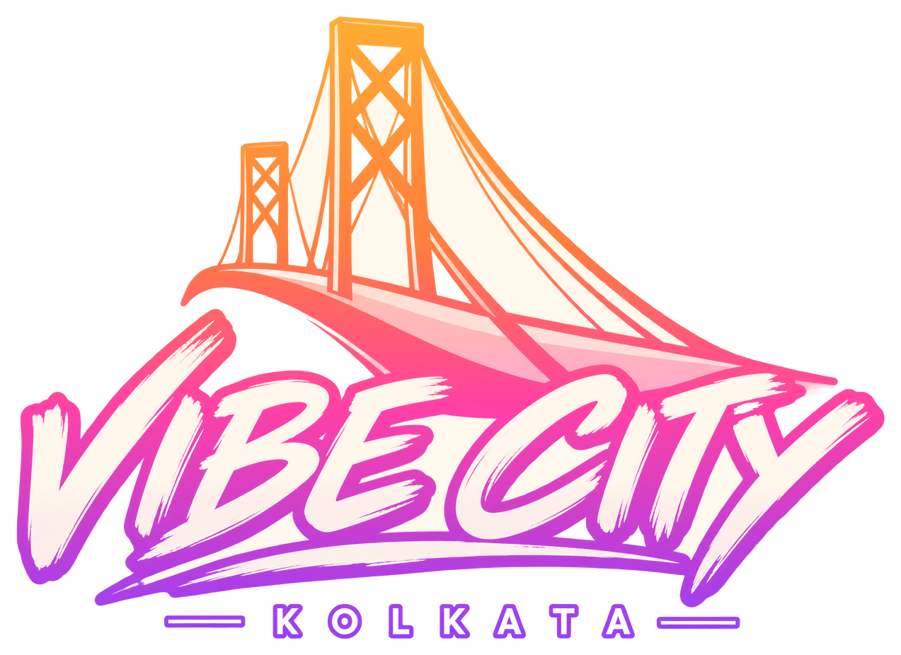
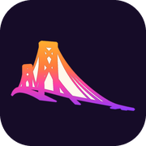

<div align="center">



### An open-world Kolkata you can play in the browser

From Howrah Station, over Howrah Bridge, to Park Street. Built from real OpenStreetMap data.

<br />

[](https://vibecityy.vercel.app)


<sub>
<a href="#-quick-start">Quick start</a> ·
<a href="#%EF%B8%8F-the-map">The map</a> ·
<a href="#-controls">Controls</a> ·
<a href="#-features">Features</a> ·
<a href="#%EF%B8%8F-tech-stack">Tech stack</a> ·
<a href="#-project-structure">Project structure</a>
</sub>

</div>

<br />

Walk, drive, ride and fight your way from **Howrah Station** across **Howrah Bridge** to B.B.D. Bagh, Esplanade, the Maidan, Victoria Memorial and Park Street, through the lanes of north Kolkata and out to Sealdah. Take a yellow taxi, a tram, an EMU local or the Rajdhani, go underground on the Metro's Blue and Green lines (under the Hooghly), or cross the river on a ferry launch.

> [!NOTE]
> No backend and no server. Apart from the map data and the logo, every building, vehicle, person, texture and sound is generated in code when the game loads.

<table>
<tr>
<td width="33%" valign="top">

**🗺️ The real city**<br />
~25,000 buildings, every street, the Hooghly and ~600 named places, at true scale (1 unit = 1 metre).

</td>
<td width="33%" valign="top">

**🚋 Every way to get around**<br />
Ambassador taxis, autos, hand-pulled rickshaws, buses, trams, EMU locals, the Rajdhani, both Metro lines and ferries.

</td>
<td width="33%" valign="top">

**🌗 Kolkata time**<br />
Runs on the real IST clock. At night, Howrah Bridge and Vidyasagar Setu light up.

</td>
</tr>
<tr>
<td valign="top">

**🗣️ Bengali voices**<br />
Locals chat out loud in Bengali: <i>"Ki khobor, dada?"</i>

</td>
<td valign="top">

**🎫 Station life**<br />
Ticket windows, cha and phuchka stalls, departure boards, and a TTE who fines you ₹250.

</td>
<td valign="top">

**🏎️ Drive, ride or fight**<br />
Drifts, nitro, damage, seven weapons, and a GPS that keeps to one-way streets.

</td>
</tr>
</table>

---

## 🚀 Quick start

You need [Node.js](https://nodejs.org/) 18 or newer.

```bash
npm install      # install Three.js and Vite
npm run dev      # start the dev server, then open the printed URL
```

| Command | What it does |
|---|---|
| `npm run dev` | Starts a local dev server with hot reload |
| `npm run build` | Builds a static, production-ready site into `dist/` |
| `npm run preview` | Serves the built `dist/` folder locally |
| `npm run build:map` | Rebuilds `src/data/kolkata.json` from the OpenStreetMap files in `map-data/` |
| `npm run build:voices` | Records every Bengali line in `src/lines.js` into `public/voices/` (macOS, Bengali voice "Piya") |
| `node tools/fetch-region.mjs` | Downloads Kolkata-wide railway lines and places for the map and search |

The `dist/` folder is plain static files, so you can host it on any static host (GitHub Pages, Netlify, Vercel, itch.io and so on).

> [!TIP]
> **Time:** the game runs on the real clock in Kolkata (IST): day there is day in the game, night is night. To try another time, add `?t=HOUR` to the URL, e.g. `?t=21.5` for night (Howrah Bridge and Vidyasagar Setu light up).

---

## 🗺️ The map

The city is real: `tools/build-map.mjs` reads every OpenStreetMap export in `map-data/`, merges them, and writes `src/data/kolkata.json`.

- **Projection:** latitude/longitude are converted to metres around the centre of the downloaded area (x = east, z = south). One game unit is one real metre, so distances, street widths and building footprints are true to life.
- **What's used:** roads (with class, width, lanes, one-way and bridge tags), ~25,000 building footprints, the Hooghly's banks, ponds, tanks and canals, parks and the Maidan, railway tracks and platforms, tram lines, the Metro routes and stations, ferry routes and ghats, and ~600 named places.
- **Heights:** few buildings in OSM have a height, so the rest are estimated from type, size and district (low old houses up north, taller offices round B.B.D. Bagh and Chowringhee). Landmarks get their real heights.
- **Adding areas:** export more of Kolkata from [openstreetmap.org](https://www.openstreetmap.org) (Export → `map.osm`), drop the file into `map-data/`, and run `npm run build:map`. Anything outside the downloaded tiles is drawn as low-detail skyline.

Map data © [OpenStreetMap](https://www.openstreetmap.org/copyright) contributors, available under the Open Database License.

---

## 🎮 Controls

| Key | On foot | In a vehicle |
|---|---|---|
| **W A S D** / arrows | Move (relative to the camera) | Accelerate, brake/reverse, steer |
| **Mouse** | Look around (click the screen to lock the mouse) | Look around (recentres automatically) |
| **Shift** | Sprint | Nitro boost |
| **X** | Toggle walk / jog | — |
| **Space** | Jump | Handbrake (drift) |
| **V** | Ride as a passenger: hire a taxi, auto or rickshaw (pick a destination on the map, pay on arrival), or board a bus, tram, train, Metro or ferry (pay the fare) | Hold **T** to hurry a hired ride along |
| **F** | Enter the nearest vehicle (you'll pull out a traffic car's driver; trams and trains must be stopped) | Exit (bail out and roll if you're going fast) |
| **E** | Buy at a station stall or ticket window; talk to a nearby person (with fists or bat in hand) | — |
| **1–7** / **mouse wheel** | Fists, Baseball Bat, Pistol, SMG, Shotgun, Assault Rifle, Sniper Rifle | — |
| **Right click** (hold) | Aim (sniper: scope). With fists: raise your guard | — |
| **Left click** / **J** | Fire, or punch / kick (a 4-hit combo) / swing the bat | — |
| Hold **Tab** | Weapon wheel (time slows while it's open) | — |
| Hold **G** | Gestures: Wave, Dance, Point, Thumbs Up, Cheer, Shrug, Flex, Laugh | — |
| **H** | — | Horn or bell (startles nearby people) |
| **R** | Reload | Reset the vehicle onto the nearest road |
| **C** | Change camera distance | Cycle chase / far / hood camera |
| **Q** | Background music on/off | Background music on/off |
| **M** | Map: drag, scroll to zoom, click to set a waypoint, right-click to clear | Map |
| **N** | Mute everything | Mute everything |
| **Esc** | Pause (shows the full key guide) | Pause |

🎮 **Gamepads work too:** left stick to steer, triggers for throttle and brake (aim and fire on foot), D-pad left/right to switch weapons, A for handbrake, B or RB for nitro, Y to enter or exit, X to talk, LB for the camera.

---

## ✨ Features

Click a section to expand it.

<details>
<summary><b>Kolkata</b></summary>

- **Real streets:** every road from the OSM data, at its real width, with pavements, centre lines and street lights on the main roads. Traffic **keeps left**, as in India, and respects one-way streets.
- **Buildings:** all ~25,000 footprints extruded to their (estimated) heights, in a Kolkata palette: ochre, pink, cream and whitewashed walls with arched windows, louvred green shutters, balconies and monsoon streaks; shop fronts at street level on the main roads; black water tanks on the roofs. Writers' Building, the High Court and Howrah Station are red brick.
- **The Hooghly:** the river's real banks with stone embankments, a muddy, silty surface, ponds and tanks (Lal Dighi, the Fort William moat, Victoria Memorial's pools).
- **Parks and trees:** the Maidan, Eden Gardens, Victoria Memorial's gardens and every park, with banyan-like trees and coconut palms along streets and lawns.

</details>

<details>
<summary><b>Landmarks</b></summary>

Modelled in code and placed on their real footprints:
- **Howrah Bridge (Rabindra Setu):** the cantilever truss with its two 82 m towers, anchor arms, suspended span and K-bracing, a raised deck you can drive or walk across, and LED lighting at night.
- **Howrah Station:** the red-brick headhouse with six towers and clock faces facing the river, the concourse roof, and 15 platforms with sheds.
- **Victoria Memorial:** white marble, the great dome and its Angel of Victory, corner chhatris and the north porch; floodlit after dark.
- **Shaheed Minar**, **Eden Gardens** (stands and floodlight towers), **St Paul's Cathedral**, **Nakhoda Masjid** (domes and minarets) and **James Prinsep's memorial** at Prinsep Ghat.

</details>

<details>
<summary><b>Howrah Station</b></summary>

- **Ticket window** (₹10, valid five minutes) and stalls on the concourse and forecourt: **cha**, **jhalmuri**, **phuchka**, **mishti** and fruit restore health; the **A.H. Wheeler** book stall sells the paper. Press **E** at a counter.
- **The TTE:** step onto the platforms without a ticket and the ticket examiner comes after you. Get caught and it's a ₹250 fine.
- **Trains:** two EMU locals and a Rajdhani Express start from Howrah's real platform tracks, two more locals from Sealdah. Each runs out along the real line and back.
- **Outside:** buses waiting at Howrah Bus Station, yellow taxis at the rank, ferries at Howrah Ghat.

</details>

<details>
<summary><b>Rail and Metro</b></summary>

- **Trams:** the three longest tram lines in the data, white with a blue stripe, under overhead wires, stopping every few hundred metres.
- **Circular Railway:** a local along the river through Prinsep Ghat, Eden Gardens, B.B.D. Bagh and Barra Bazar.
- **Kolkata Metro:** the **Blue Line** (Shobhabazar – Girish Park – MG Road – Central – Chandni Chowk – Esplanade – Park Street – Maidan – Rabindra Sadan) and the **Green Line** (Howrah Maidan – Howrah – *under the Hooghly* – Mahakaran – Esplanade – Sealdah) on their real routes. Each station is a tiled hall lined up with the track, with a stairway up to the street and a Metro sign at the entrance.
- Platform boards in **Bengali, Hindi and English**. Walk up to either cab of a stopped tram, train or metro and press **F** to drive it.

</details>

<details>
<summary><b>River</b></summary>

- **Ferry launches** work the real ferry routes between the ghats on autopilot, docking at floating pontoon jetties. Board one from the jetty (**F**) and take the wheel; step off and it carries on.
- **Country boats (nouka)**, a speedboat and a jet ski moored at the ghats; a **river cruise steamer** and a **cargo barge** work up and down the river.

</details>

<details>
<summary><b>Vehicles</b></summary>

- **Cars:** Convertible, Sports Coupe, Sedan, Taxi and Van; **heavy and two-wheeled:** Motorbike, Pickup, Box Truck, School Bus and City Bus. Each has its own handling, mass, engine note and camera distance. West Bengal number plates.
- **Physics and damage:** mass-based collisions, weight transfer, drifts, nitro, smoke, fire and explosions, as before. Collisions use the real building outlines.

</details>

<details>
<summary><b>Map and navigation</b></summary>

- **Full-screen map (M):** the real streets, buildings, river, parks, railways, tram lines and both Metro lines, with neighbourhood, landmark, station and ghat names by zoom level.
- **Waypoints:** click anywhere and the GPS finds a route along Kolkata's streets, obeying one-way rules, shown on the map and minimap.

</details>

<details>
<summary><b>People</b></summary>

- **Locals** walk the pavements and footpaths of the real streets, in Kolkata looks, and talk in English and Bengali ("Ki khobor, dada?"). Talk to them, wave, start a dance, or start a fight: combat works as before.

</details>

<details>
<summary><b>Gameplay</b></summary>

- **Money in ₹:** cash pickups on the pavements; spend it on fares, tickets and street food. No missions or timers: just the city.

</details>

<details>
<summary><b>Ride or drive</b></summary>

Every vehicle offers two choices: **F** to drive it yourself, **V** to ride as a passenger.
- **Taxi, auto-rickshaw, hand-pulled rickshaw:** the driver asks "Kothay jaben, dada?" and the map opens; search or click a destination. He quotes a fare, drives you there along the streets (keeping left, waiting in traffic, honking), and you pay on arrival: taxi ₹30 for the first 2 km then ₹15/km, auto ₹20 then ₹10/km, rickshaw ₹30 then ₹25/km (up to 2.5 km). Press F to get off early and pay the meter.
- **Bus:** ₹10 to the conductor; it runs a route along the main roads and stops every few hundred metres. F gets you off at the next stop.
- **Trains, trams, Metro:** board any car of a stopped train (₹10 local, ₹7 tram, ₹20 Metro, ₹120 Rajdhani). The next station is announced at each stop; F gets you off there. A train ticket also satisfies the TTE.
- **Ferry launch:** ₹6, get off when it docks at a ghat.

</details>

<details>
<summary><b>Stations and timetables</b></summary>

- **Departure boards** at Howrah (the big concourse board), every railway platform, every Metro platform and every tram stop: train number, destination (Bandel, Bardhaman, Krishnanagar, Canning, Dum Dum…), platform, and minutes to arrival, worked out from where each train really is, on the real Kolkata clock.
- **Trains and trams** run more often: seven out of Howrah, four out of Sealdah, two on the Circular Railway, two trams a line. Every train stops properly at every station.

</details>

<details>
<summary><b>Trains and trams (Indian designs)</b></summary>

- **EMU local:** silver with a maroon band, three open doorways a side, barred windows, the flat yellow cab with its red band, a pantograph.
- **Rajdhani Express:** a WAP-7 electric locomotive and red LHB coaches with a cream stripe.
- **Kolkata tram:** WBTC white over blue, grilled windows, the white chevron, red rounded roof, route board and trolley pole.
- **Overhead catenary** masts and wires along the electrified main lines.

</details>

<details>
<summary><b>Dharmatala bus stand</b></summary>

- The Esplanade bus terminus beside Shaheed Minar: shelters, a ticket booth, and buses in their bays with route boards (12C/1 Howrah Stn, S-163 Shobhabazar, 24B Sealdah, S-101 B.B.D. Bag, RT-27 Park Circus, 213 Babughat). Board one with V (₹10) and it takes you there, stopping on the way.

</details>

<details>
<summary><b>More of Kolkata</b></summary>

- **Vidyasagar Setu:** the cable-stayed bridge, 457 m main span, two H pylons and fans of stays, its deck 26 m over the river.
- **Heritage buildings** on their real footprints: Writers' Building (red brick, portico, statues), Town Hall (Doric portico), Indian Museum (colonnade), New Market (Hogg Market clock tower), Birla Planetarium (dome), Marble Palace, Presidency.
- **Streets:** dark asphalt, Kolkata's black-and-yellow kerbs, white edge lines, hawkers' stalls under blue, orange and yellow tarps along the busy pavements.
- **Conversations** that make sense: ask "Esplanade kon dike?" and you're told which way and how far from where you're standing.
- **Horns** only from real vehicles near you.

</details>

<details>
<summary><b>Railways</b></summary>

- Inside the playable city: seven trains out of Howrah, three out of Sealdah plus a **Sealdah South** local via Park Circus, and the **Circular Railway** along the river, each stopping at its real stations and waiting at the terminus so there's usually one at the platform.
- On the map: the whole suburban network (Sealdah–Dankuni, Bangaon, Hasnabad, Canning, Budge Budge, Namkhana; the Howrah main lines and chord) and every Metro line in its colour, plus ~1,700 named places across the region for the search.

</details>

<details>
<summary><b>Vehicles of Kolkata</b></summary>

- **Auto-rickshaw:** the green-and-yellow three-wheeler with a black canvas hood and a two-stroke putter.
- **Hindustan Ambassador:** the yellow taxi (with its blue side stripe) and the white or black private car, with the round nose, chrome bumpers and round headlamps.
- **Buses** in four liveries: W.B.T.C. (white and blue), SBSTC (white, blue and green), and two private-bus paint jobs, each with a route board in Bengali and English.
- **Hand-pulled rickshaw:** big wooden wheels, a hooded seat and the puller walking between the shafts. It's slow, and you can ring its bell (H).
- **Trams** in WBTC white and blue with red roofs and route boards; **EMU locals** with yellow cab fronts; **Metro** rakes in each line's colour.

</details>

<details>
<summary><b>Sound</b></summary>

- **Background music is off by default.** Toggle it with **Q** or the **MUSIC** button on the title screen and pause menu. The choice is remembered.
- **City sounds:** a traffic bed, distant honking, crowd murmur, crows by day and water near the river.
- **Engines** by kind: the Ambassador's low petrol note, buses' diesel clatter, a motorbike's buzz, the electric whine and rail-joint clack of trains, trams and the Metro, the rickshaw puller's footsteps. Each vehicle has its own horn or bell.
- **Bengali voices:** everyone speaks Bengali out loud. The speech bubble shows the romanised line ("Kemon achho?"); the voice is a Bengali recording (`public/voices/`, made with `npm run build:voices`), panned to the speaker and quieter with distance, pitched down for men. Toggle with the **VOICES** button.

</details>

<details>
<summary><b>Metro details</b></summary>

- Street entrances are grey portals with red Bengali and English station signs; blue boards over the platforms list the stations ahead, in Bengali and English.
- **Under the Hooghly:** between Howrah and Mahakaran the Green Line runs through a round bored tunnel 26 m down, with a message when you cross under the river.

</details>

<details>
<summary><b>Map</b></summary>

- **Search** box (top of the full map): type a place, station, ghat, tram stop or landmark and pick a result to fly there and set a waypoint.
- Metro stations (M) and tram stops (T) are marked and named on the map.

</details>

<details>
<summary><b>Day and night, combat and HUD</b></summary>

Unchanged: the full day/night cycle, seven weapons and the HUD all carry over.

</details>

<details>
<summary><b>Approximations</b></summary>

- Landmarks are recognisable models at real scale, not survey-exact replicas.
- Flyovers are drawn at street level; only Howrah Bridge (and small bridges over ponds and canals) has a raised deck.
- Building heights are estimated wherever OSM doesn't record them.

</details>

---

## 🛠️ Tech stack

| Area | What's used |
|---|---|
| **3D engine** | [Three.js](https://threejs.org/) r170 (WebGL 2) |
| **Build tool** | [Vite](https://vitejs.dev/) 5 |
| **Language** | Plain modern JavaScript (ES modules), HTML and CSS. No UI framework. |
| **Fonts** | Google Fonts: *Bebas Neue* and *Rajdhani* |
| **Audio** | Web Audio API (no audio files) |

#### Three.js add-ons used
- `Sky`: physically based sky dome
- `Water`: the reflective river surface
- `Lensflare`: sun flare
- `EffectComposer`, `RenderPass`, `UnrealBloomPass`, `GTAOPass` (ambient occlusion), `SMAAPass` (anti-aliasing), `OutputPass`, `ShaderPass`
- `BufferGeometryUtils.mergeGeometries`

#### Rendering techniques
- Physically based materials, with clear-coat car paint.
- **Image-based lighting:** the environment map is rebuilt from the sky as the sun moves.
- **Shadows:** soft PCF shadows that follow the player.
- **Post-processing:** bloom, ambient occlusion (Ultra only), and a custom colour grade (chromatic aberration, nitro speed blur, split toning, vignette, film grain), then SMAA.
- **Custom GLSL shaders:** procedural clouds, fake volumetric light cones and GPU particles.
- **Characters:** one skinned mesh per person, procedurally rigged, with smooth two-bone weights at the joints and procedural animation: a gait cycle with heel strike, push-off and a running flight phase, body lean into turns, idle weight shifts, eight gestures, sitting, riding, falling, punch/kick/bat strikes, and pistol and rifle aiming poses.
- **Weapons and vehicles:** every gun, vehicle, tram and train is modelled in code from primitives, extrusions and rounded boxes.

#### Performance
- **Level of detail:** full trees, palms, rooftop tanks and hawkers' stalls only near the camera; simple versions or nothing beyond. Trains, parked vehicles and the underground metro are only drawn when near.
- **River reflection:** redrawn only near the river, every third frame, without trees and glows; shadows update at half rate; nothing is drawn beyond the haze (~3 km).
- **No black flashes:** invalid pixels are scrubbed before the bloom pass.
- **Fewer draw calls:** buildings are merged by material in 800 m chunks; trees, palms, rooftop tanks, street lights and light cones use instancing.
- **Distance detail:** far cars drop wheel and trim detail; far people animate less often and stop casting shadows.
- **Cheaper reflections:** the river reflection updates every other frame and skips people, traffic and particles.
- **60 fps cap:** high-refresh displays don't do extra work.
- **Adaptive resolution:** the render resolution scales with frame rate.
- **Lighter HUD:** the minimap and speedometer redraw 30 times a second, and text updates only when it changes.
- **Static world:** fixed objects skip per-frame transform updates.
- **Quality presets** on the title screen:

  | Preset | Max pixel ratio | Shadow map | Ambient occlusion | People / traffic |
  |---|---|---|---|---|
  | Ultra | 2.0 | 4096 | On | 44 / 26 |
  | High (default) | 1.5 | 2048 | Off | 38 / 24 |
  | Medium | 1.0 | 1024 | Off | 26 / 18 |

  People and traffic counts apply on the next page load.

---

## 📁 Project structure

```
index.html          Page shell: HUD, title screen, pause overlay
assets/             Source artwork (the original logo)
public/             Served as-is: logo, favicons, recorded voices/
map-data/           OpenStreetMap exports (*.osm, not committed) and reference images
tools/
  build-map.mjs     Turns map-data/*.osm into src/data/kolkata.json
src/
  data/kolkata.json Kolkata map data (generated)
  geo.js            Map data access, polygons, polylines, spatial grid, road graph,
                    route-finding and walking paths
  main.js           Boot, main loop, cameras, quality presets, wiring
  world.js          Kolkata: ground, river and embankments, roads, buildings, parks,
                    trees, street lights, bridge decks, skyline, colliders
  landmarks.js      Howrah Bridge, Howrah Station, Victoria Memorial, Shaheed Minar,
                    Eden Gardens, St Paul's, Nakhoda Masjid, Prinsep memorial
  station.js        Howrah Station life: stalls, ticket window, TTE, buses and taxis
  trains.js         Indian rolling stock (EMU, WAP-7 + LHB, Kolkata tram) and overhead catenary
  boards.js         Departure boards with live arrival times
  busstand.js       The Esplanade (Dharmatala) bus terminus and its routes
  ride.js           Riding as a passenger: hired taxis/autos/rickshaws, buses, trains, ferries
  lines.js          Everything people say: romanised Bengali + Bengali script
  voice.js          Plays the recorded Bengali lines
  textures.js       Procedural canvas textures (asphalt, facades, roofs, ground…)
  sky.js            Day/night cycle, sun/moon, clouds, stars, lens flare, environment map
  character.js      Procedural skinned humanoid, outfits, animation and gestures
  player.js         On-foot controller, entering/exiting vehicles, interactions
  peds.js           Pedestrian AI, reactions and dialogue
  car.js            Car models, materials, arcade physics, damage, level of detail
  fleet.js          Pickup, box truck, school bus, city bus and motorbike models
  rail.js           Tracks, platforms, trams, EMU locals, the Rajdhani, Circular Railway
  metro.js          Kolkata Metro: Blue and Green lines, stations, tunnels, trains
  boats.js          Launches, country boats and other boats, ghats, river traffic
  mapview.js        Full-screen map, place names and waypoints
  traffic.js        AI traffic on the road graph, hijack/crash hand-off
  weapons.js        Weapon stats, gun models and the player's arsenal
  combat.js         Bullets, tracers, decals, explosions and area damage
  gameplay.js       Cash and ammo pickups
  effects.js        Particles (smoke, sparks, nitro flame) and skid marks
  post.js           Post-processing chain and colour-grade shader
  hud.js            Minimap, speedometer, notifications, bubbles, gesture wheel
  audio.js          Synthesised engine, sound effects and radio
  input.js          Keyboard, mouse (pointer lock), gamepad, gesture wheel
  utils.js          Maths and geometry helpers
  style.css         HUD and menu styling
```

In development builds (`npm run dev`), `window.__kol` exposes the scene, world and player for debugging, and setting `__kol.freeCam = { p: [x, y, z], t: [x, y, z] }` flies the camera anywhere.

---

## 🌐 Browser support

Works in any up-to-date desktop browser with WebGL 2: Chrome, Edge, Firefox or Safari. A dedicated GPU is recommended for the Ultra preset. Touch controls aren't implemented yet, so mobile isn't supported.

---

## 📝 Notes

- **Map data:** © OpenStreetMap contributors, under the Open Database License. Keep the attribution if you publish the game.
- **Original work:** the game's code, models and art are original. Kolkata's streets and landmarks are real places, modelled from open map data.

<div align="center">
<br />

<br />
<sub>Made with ❤️ for the City of Joy</sub>
</div>
